### What do window fucntions do ?

- perform aggregation on sub-set of data without lossing row level granularity **unlike GROUP BY** where we loose granularity


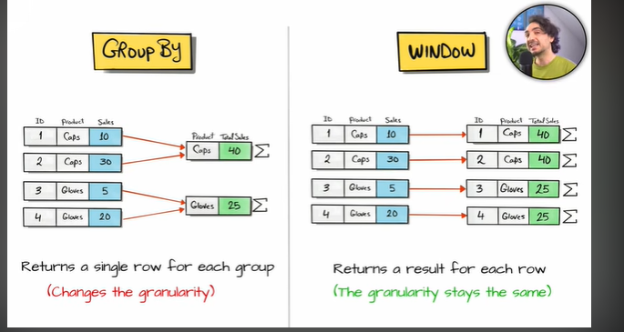


-----------------------------------------------------------------------------------------------------

- functions available in group by vs in window functions :

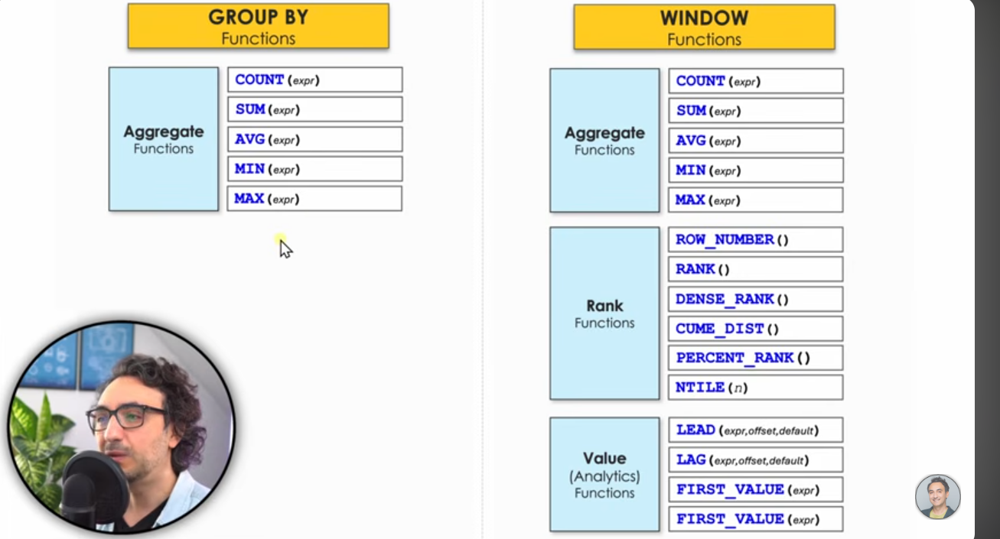


----------------------------------------------------------------------------------------------------

### Eg :

```sql
Task : Find the total sales for each product , additionally provide details such as order id and order date

if we simply use GROUP BY productid, orderid , orderdate, we wont be doing correc aggregations !! we wanna aggregate based on productId only but since GROUP BY statement does not allow (has restrictions of select cols and group by clause stuff and all) it wont work.

Window function returns a result for each row (Result Granularity)

SELECT 
    orderId,
    orderDate,
    ProductId,
    SUM(sales) OVER(PARTITION BY ProductId) as TotalSalesByProduct
From Orders;

partition by is just a way to tell " group by what " in window functions !!!!

```


### Syntax for window functions :

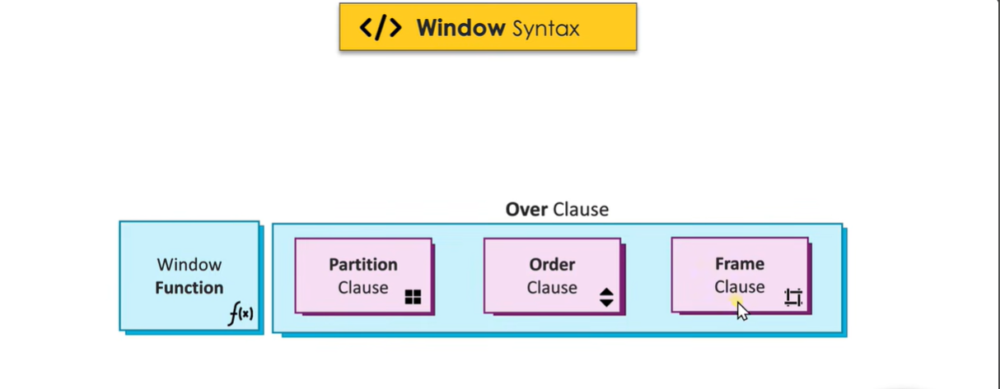


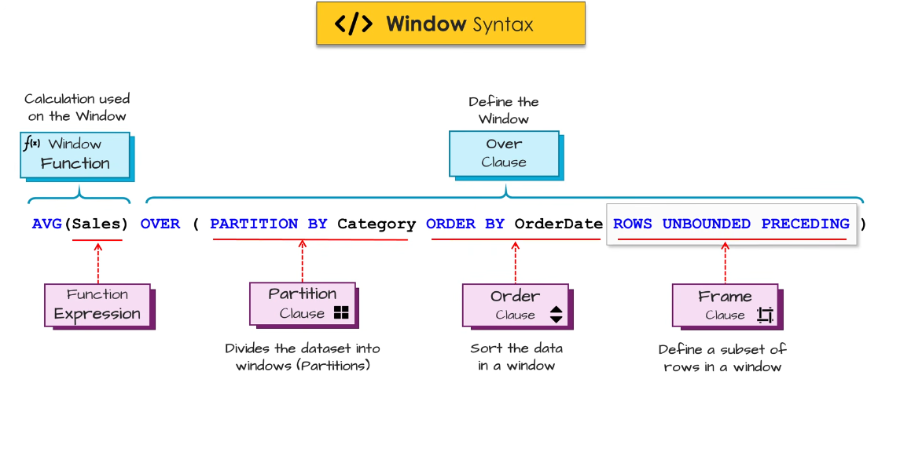


-----------------------------------------------------------------------------------------------------

- The value which we pass in the window function as an argument (also called as **function expression**) can be of many types as below :

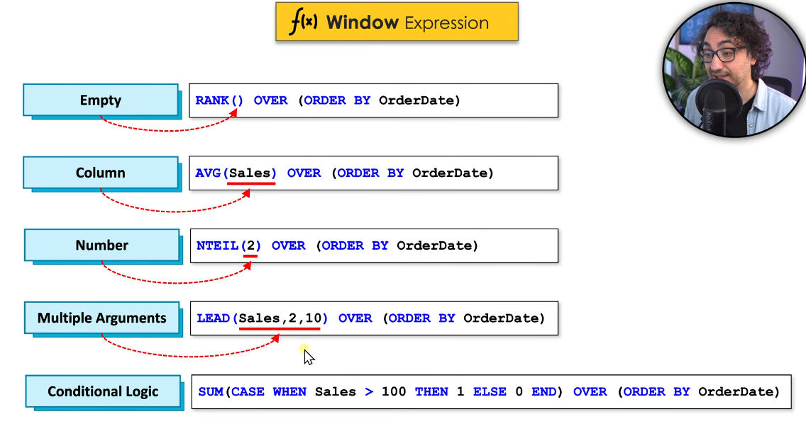

- What kind of data type do these window functions accept ? :

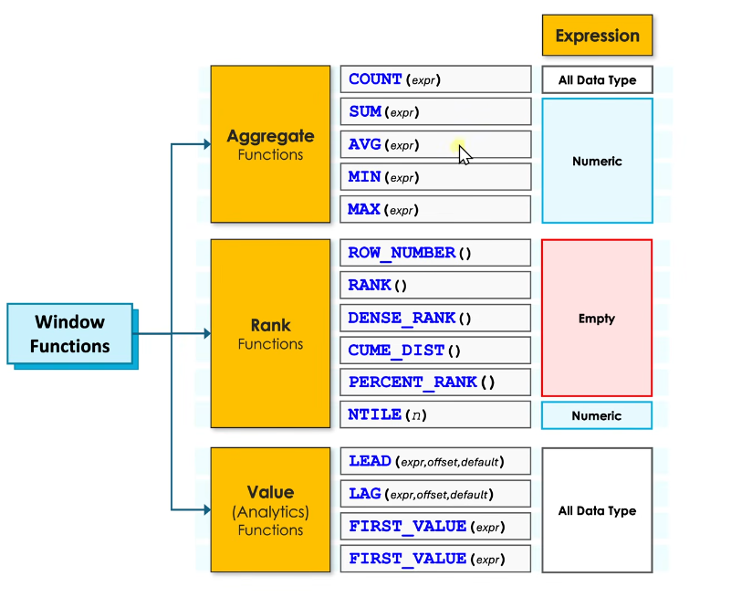    


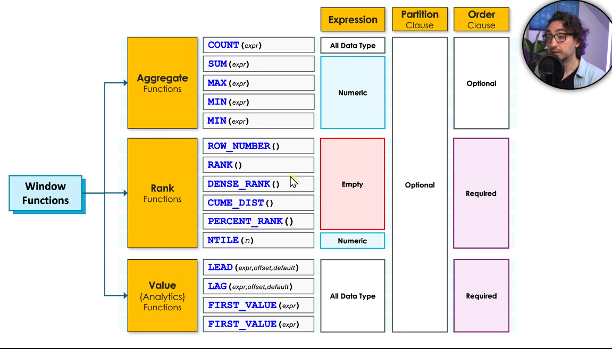


----------------------------------------------------------------------------------------------------

- the OVER() clause tells sql that we are dealing with window functions 

### Partition By :

- Partition by is very similar to group by , what ever columns we specify in Partition by , the groups will be made on those common col values

- if we dont define Partition by then the grouping will happen on entire table dataset

- u can use Partition by with multiple columns in it

- Partition By is optional in all of the window funtions !!


```sql
Task : find the total sales for each product, additionally provide info such as orderId and orderDate
       also find the totalsales across all the products

SELECT
OrderId,
OrderDate,
ProductId,
sales,
SUM(sales) OVER( ) as totalsales
SUM(sales) OVER(PARTITION BY ProductId) as totalsalesByProduct
from orders;

we have 3 granularities for sales now, the sales for each order, sales for each product category and total sales across all products

```


```sql
Task : find the total sales for each combination of product and order status

Select
*,
SUM(sales) OVER (PARTITION BY productId, OrderStatus) as t_sales
from orders;

```


----------------------------------------------------------------------------------------------------

### Order By :

- sorts the data within the window

```sql
Task : Rank each order based on their sales from highest to lowest for each product
       Provide additional info like orderId and orderDate  

SELECT 
orderId,
orderDate,
sales,
productId,
RANK() OVER( Partition by productID  ORDER BY sales DESC) as ranking  1,2,3,.....n  1,2,3,4...n
from orders;

the ranking will be from 1,2,3,,,,n for each window , the windows are being formed based on productId   

```

------------------------------------------------------------------------------------------------------

### Window Frame :

- Defines a subset of rows within a window that are relevant for the calculation

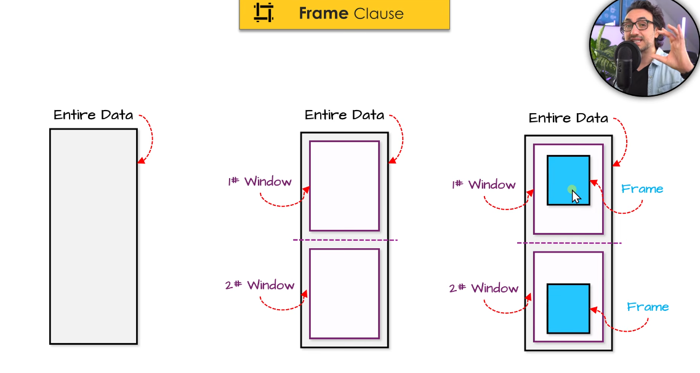


- **Syntax for Frame clause**

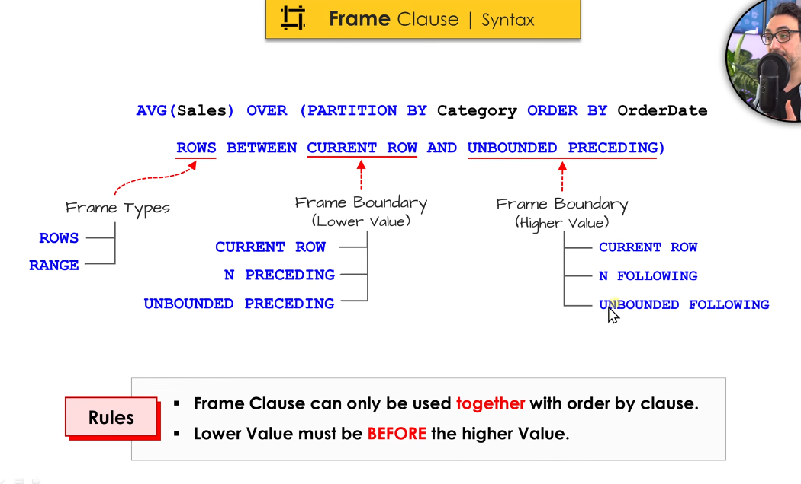

- look at below image to get a feel 

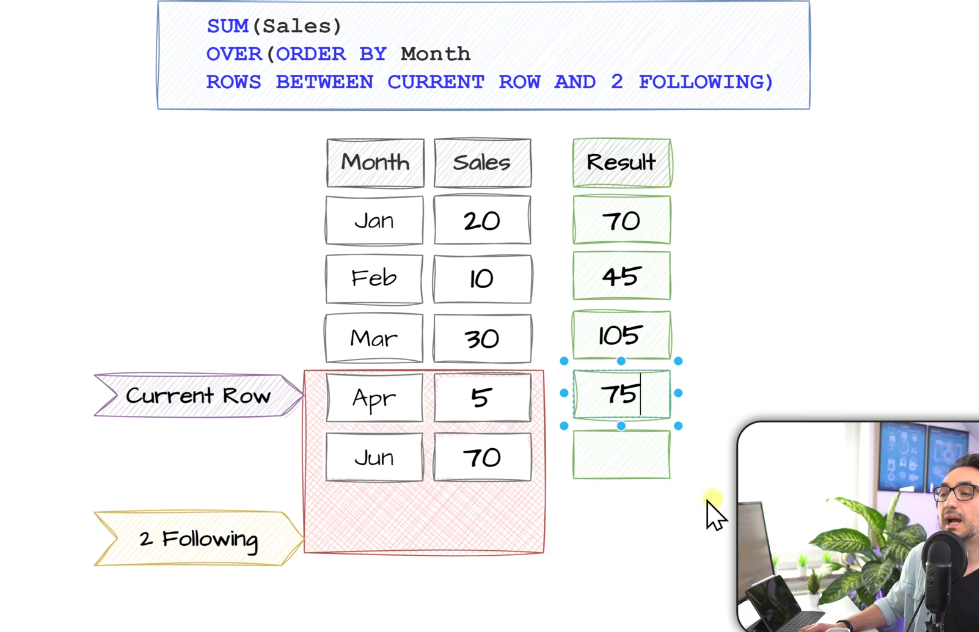  


- also look at 2 below eg. see what words are being used to define boundaries

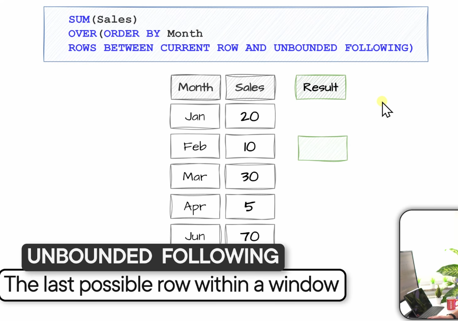

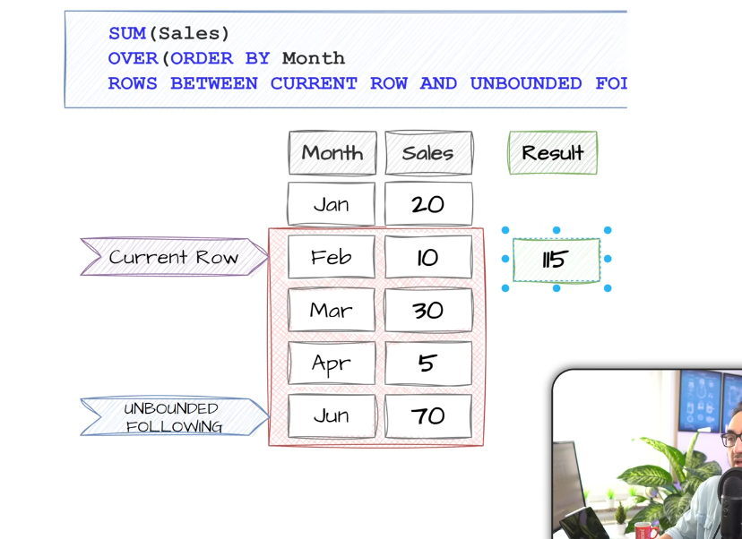


- now look at this :

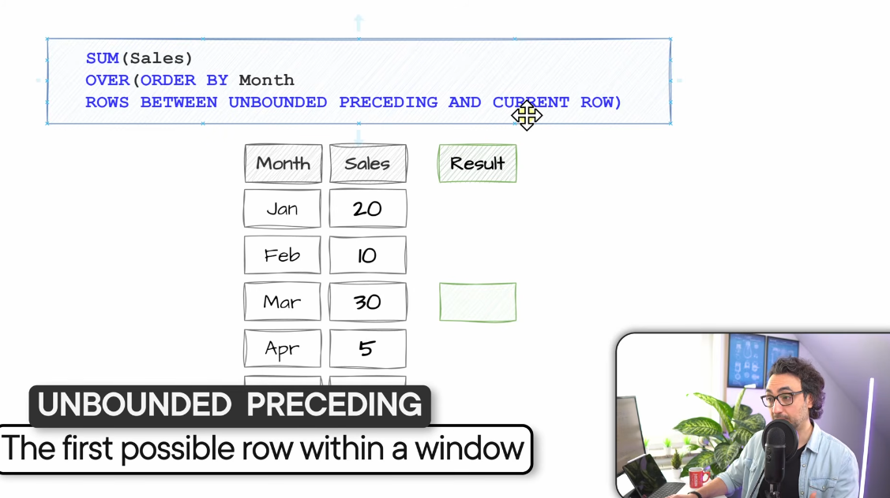


### The crux is to understand the wordings, u know current row, and what n following and n precedding mean now unbounded means the last row of a window, if its unbounded preceding then it means from current row to the top most starting row of the window and if its unbounded following then it means till the last row of a window , use any combo but just think logically will that be correct window ? always think in terms of stuff happening to CURRENT ROW

### And what is gonna happen between these frames ?? the window function u define !!

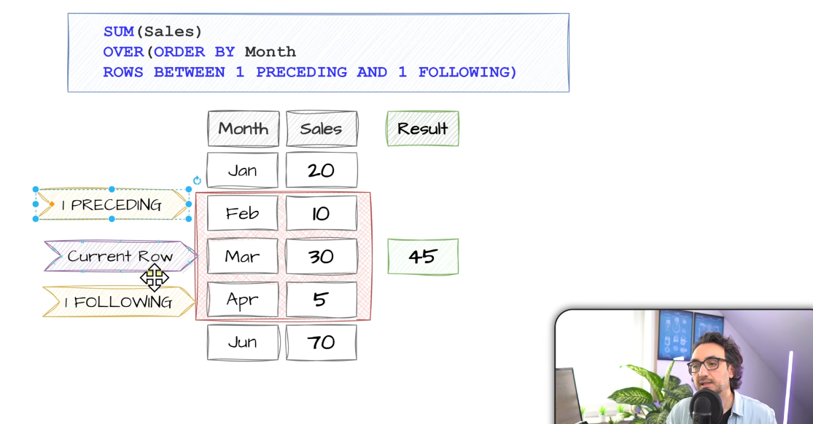


-----------------------------------------------------------------------------------------------------

### Default frame :

if u are using ORDER BY and dont specify frame clause then default frame is : 
**Rows Between UNBOUNDED PRCEDING and CURRENT ROW**


--------------------------------------------------------------------------------------------------


### Window Function 4 Rules :

1) Window function can only be used in SELECT and ORDER BY clause 

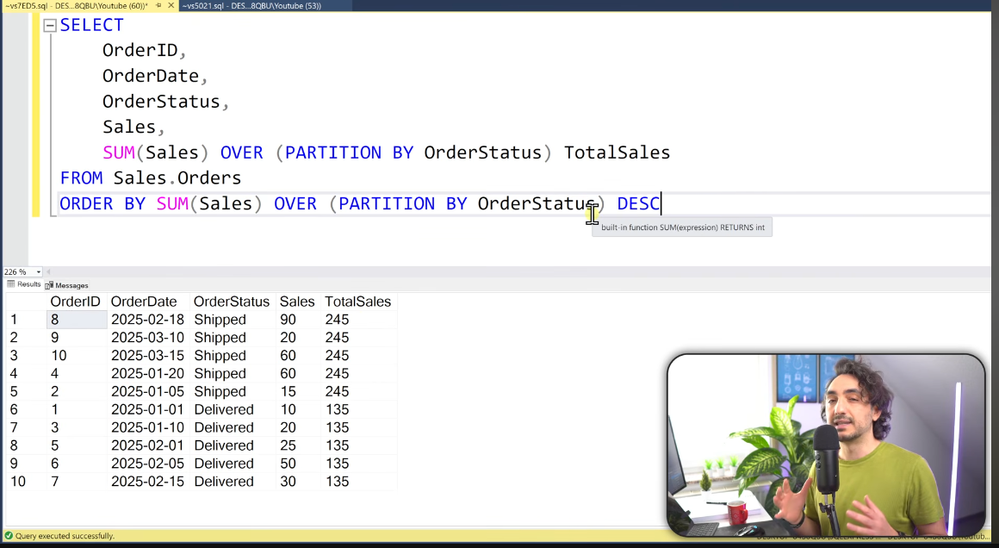

- window function in select and ORDER by can be different , they are independent its not like u have to repeat the same stuff in order by again , no such restriction 

```sql
SELECT
    emp_name,
    dept,
    amount,
    RANK() OVER (PARTITION BY dept ORDER BY amount DESC) AS dept_rank
FROM sales
ORDER BY AVG(amount) OVER (PARTITION BY dept) DESC;

```


2) Nesting of window function is not allowed 


3) SQL execute window function after where clause 

4) Window function can be used together with group by clause in the same query , ONLY if the columns used are same, i.e the column in Window function can only be either of select or group by statement columns

```sql
Task : Rank the customers based on their total sales

SELECT
       cust_id,
       SUM(sales) as total_sales
       RANK() OVER( ORDER BY SUM(sales) DESC ) as rank_customers    --> cant use same select alias       
from orders
group by cust_id;

the data is first grouped by cust_id and aggregated data is collected, then ranking happens on this aggregated data using window function

** Here we in above query we use window function and group by togethere the condition is that the col must be same , the col should be either part of select or group by 

EVEN THIS IS ALLOWED : 

SELECT
       cust_id,
       SUM(sales) as total_sales
       RANK() OVER( ORDER BY cust_id DESC ) as rank_customers    --> cant use same select alias       
from orders
group by cust_id;

```

the trick to think in these type of queries is to think to group first use group by and then on top of that apply window functions , something like this, this is not hard truth, depends question to question 
