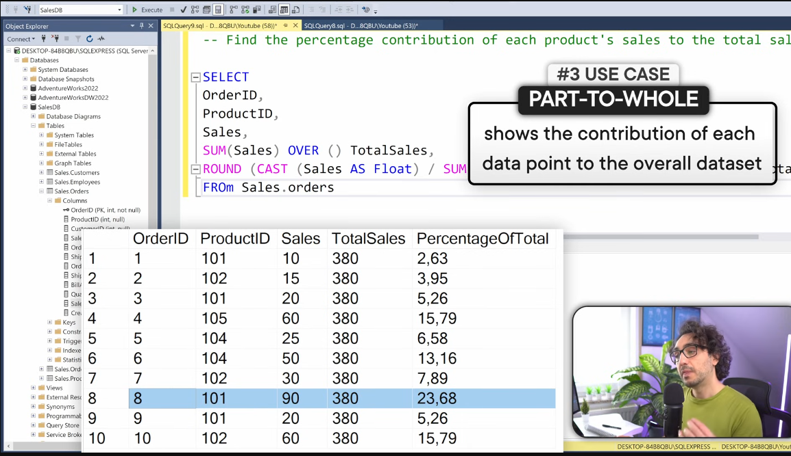
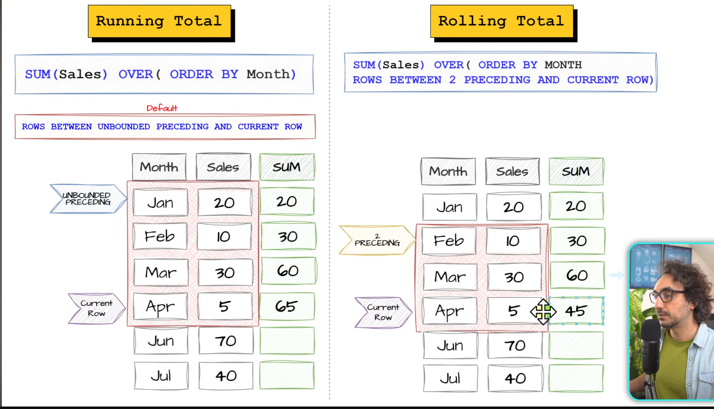
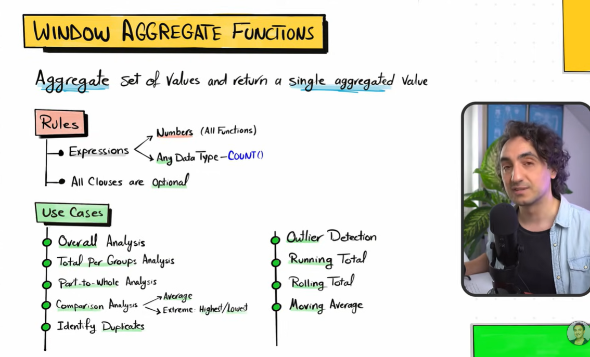

## Aggregate window function :

```sql
AVG(sales) OVER(Partition by p_id order by sales)

```

the function expression AVG(x) , SUM(x) and all must be of numeric type, but only for COUNT(names) it can be any datatype


## 1) COUNT() :

count(*) : counts all rows even if null
count(1) == count(*) same behaviour

count(sales) : only counts non-null values in sales column

counts the rows as is does not care to count distinct value, just counts everything

### USE-CASES of count()

1) identidy data quality issues

```sql
Task : check whether the table "orders" contains any duplicate row

SELECT 
orderId,
count(*) OVER(PARTITION BY orderID) as checkPK
from orders;

1 as value in checkPk for each orderId , if theres no. 2 or more , then its duplicate, but still in this approach we have to scroll and see manually if no in checkPk col is 1 or something else !!

Task : now from above i only need order who are double i.e more than once

SELECT * FROM(
    SELECT 
        orderId,
        count(*) OVER(PARTITION BY orderID) as checkPK
    from orders
    )t Where checkPK > 1;

used subquery method here

```

2) can also use count(col) and count(*) combo side by side to check NULL identification


-----------------------------------------------------------------------------------------------------

## 2) SUM()

- IGNORES NULL 
- ACCEPTS COLUMNS WHICH ARE OF INT DATATYPE

### USE-CASE :

1) Part to Whole analysis :
i.e contribution of each type to the whole 

```sql
SELECT
orderId,
p_id,
sales,
SUM(sales) OVER() as total_sales,
ROUND(CAST(sales as FLOAT)/ SUM(sales) OVER() * 100 ,2) as percentage_contribution
from orders;

percentage = individual / total * 100
use float as int/int decimals are not shown on UI
```




----------------------------------------------------------------------------------------------------------

## 3) AVG() :

- ignores null in the bottom total !!
- so there are cases where u wanna make NULL as zero and then calculate AVG including the total in bottom

```sql
AVG(COALESCE(sales,0)) OVER(PARTITION BY product)
now even the 0 will be included in the bottom total
```


```sql
Task: find all the orders where sales are higher than the average sales across all orders


SELECT
*,
AVG(sales) as avg_sale
from orders
where sale > AVG(sale)

```

----------------------------------------------------------------------------------------------------------

## 4) Min and Max :

- also ignores nulls

```sql
Task : find highest and lowest sale across all orders
       and the highest and lowest sales for each product,
       additionally provide detail: orderId and orderDate

SELECT 
orderId,
orderDate,
MIN(sale) OVER() as Min_overall,
MAX(sale) OVER() as Max_overall,
MIN(sale) Over(Partition by product_id) as prde_wise_min,
MAX(sale) OVER(PARTITION BY product_id) as prde_wise_max
from orders

```


```sql
Task : show the employees (can be multiple) with highest salary

Select
*,
Max(salary) as max_sal
from order
WHERE salary >= max_sal;

if there are more than 1 employee who have the same highest salary they will be shown as well in the ui !!!


```


------------------------------------------------------------------------------------------------------------


### Analytical use cases :

1) Running and Rolling total :

They agg sequence of members and the agg is updated each time a new member is added 

Running : Agg all values from the beginning up to the current point without droping off older data 

Rolling : Aggregate all values within a fixed window (eg. 30 days)




----------------------------------------------------------------------------------------------------------

2) Moving Average :

same as above just perform avg , decide what kind of window u want and also the frame and all

```sql
Task : calculate the moving AVG of sales for each product over time 
therefore need to sort data wrt time

SELECT 
orderId,
ProductId,
OrderDate,
sales,
AVG(sales) OVER (PARTITION BY ProductId Order By OrderDate) as Moving_avg
from orders;

the calculations will be done for every window

```

### So in nutshell :

- Window Agg functions like sum, avg, min, max , count helps us to :
  - Overall total 
  - total per groups
  - running total
  - rolling total


## Summary in nutshell :

