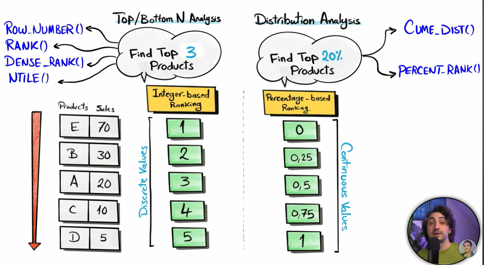
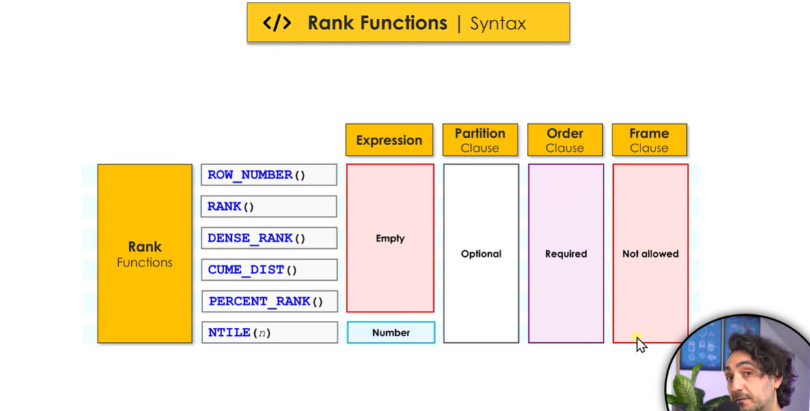
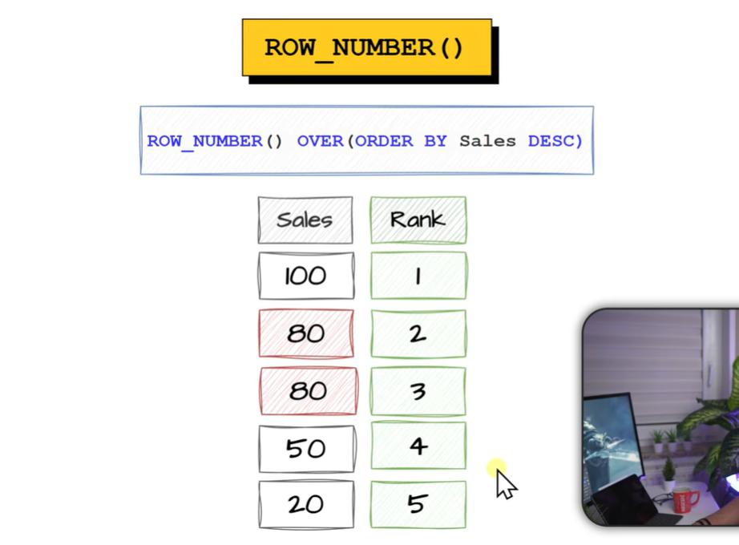

## What are Ranking window functions ? 

- They help in ranking rows
- There are 2 types of rankings : and 6 ranking functions as below : 



- Syntax

```sql
Rank() OVER (PARTITION BY p_id ORDER BY sales)

funtion expression is not given in all ranking functions except one

Partition by is optional but Order by is **MANDATORY**

Frame clause is not allowed in any !!

```




------------------------------------------------------------------------------------------------------

## 1) Row_Number() :

- Assigns a unique no. to each row, doesnt handle ties (same value tie , still different ranks)
- no skipping or gaps in ranks !




-------------------------------------------------------------------------------------------------------

## 2) Rank() :

- Assigns rank to each to row
- it handles the ties (same value gets same rank)
- it leaves gap (if 3 rows have same value, they will get same rank and the below 2 rank will be skipped)


